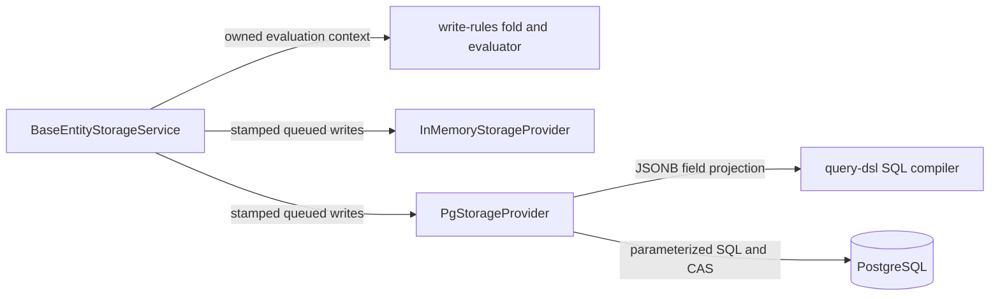

---
assigned_number: 28
created: 2026-10-30
prd: null
predicted_number: 28
slug: rfc-write-rules-remediation-atomic-providers-and-consistent-evaluation-images
updated: 2026-10-30
---

# Write-rules remediation

## Summary

Implement PRD-072 and close the eight EVID-092 readiness findings on the existing branch. All source/tests are produced by openai-codex/gpt-6-luna; independent review uses openai-codex/gpt-6.1-sol. Parent session owns integration, dependency installation, runtime checks and Forgeplan records.

## Motivation

Passing unit suites missed partial in-memory commits, incorrect post-images, inconsistent affected-key calculations and stale version acceptance. The branch needs behavioral proof, not additional SQL-string/mock-wiring assertions. Existing user React/config/lockfile edits are preserved.

## Options Considered

1. Chosen: preserve both providers' shallow literal-key patch semantics, remove nested-only affectedKeys logic, stage touched in-memory keys, and derive SQL versions atomically. Smallest correction to actual persistence contracts.
2. Rejected for this repair: introduce nested dot-path updates in every provider and post-image builder. That is a new storage feature, adds SQL patch machinery and changes existing persistence behavior.
3. Rejected: special-case individual failing predicates, suppress CAS conflicts or retain separate inconsistent fold implementations. These hide invariant violations.

## Proposed Direction

### Provider invariants

PostgreSQL updates and conflict branches of set/upsert derive update_version = stored version + 1 when the stored row is versioned; unversioned rows keep current convention. Never trust incoming version on an existing versioned row. Preserve creator audit on native upsert. Expected-version predicates remain in the atomic SQL statement. Verify actual state through a dev-only pg driver against a task-owned PostgreSQL16 container, never another project's database.

InMemory commit stages only touched keys with the existing set/update helpers and validates every op before publishing any staged value. A failed op cannot produce live writes or notifications. Initialize transaction local state at first write; use identical write semantics in the local view and commit, preserving existing disjoint-commit behavior.

### Rule/service interface shared by independent slices

- Extend PendingWrite in write-rules.ts with optional `readonly persistedData?: Readonly<Record<string, unknown>>`. It is the exact stamped payload queued into the provider, separate from caller domain patch and affectedKeys. Existing callers may omit it; lifecycle fallback stamps are computed once per post-image evaluation.
- Export `foldPendingWrite(resource: Record<string,unknown> | undefined, write: PendingWrite, session: Session): Record<string,unknown> | undefined` from write-rules.ts for internal service use (not a root public re-export). It applies shallow literal-key data, real lifecycle status/null markers, destroy absence, and provider-owned version progression. Rule worker owns implementation; service worker imports it and supplies persistedData. The function must not mutate input documents.
- Deferred get/getAfter memoize in-flight promises using collision-safe path/id keys. Keep committed resource separate from ordered final post-image.
- Service writes stamp once before evaluation, reuse that exact payload for provider writes and PendingWrite.persistedData. Single-write readers seed the prefetched target resource and share read promises for repeated/in-flight cross-document reads.
- Service routing is deferred only to an active audited runner created by the same service instance; a service-owned WeakMap registry validates ownership/lifetime before queueing. Reject foreign, expired or unregistered runners before any write, including ruleless foreign runners, rather than silently misrouting paths or bypassing claims/rules. Direct audited runner calls keep the existing callback-bound behavior. Update the older cross-service composition claim in MutationRoutingOpts documentation. No new cross-service runner protocol, aliases or compatibility shims.
- computeAffectedKeys compares the same literal map key providers persist, including dots. Remove nestedValue and root-collapsing claims/tests. hasRoleWithSource normalizes each scalar input locally, without changing generic document array parsing.

### File ownership

A PostgreSQL worker owns packages/pg-client source/tests/package.json/README and task-owned SQL smoke scripts.
B Memory worker owns InMemoryStorageProvider.ts and its provider/transaction tests.
C Rule worker owns write-rules.ts, rules-helpers.ts, write-rules.test.ts, rules-helpers.test.ts and a dedicated new post-image regression file.
D Service worker owns BaseEntityStorageService.ts, AuditedRunners.ts, service tests, write-stamps.ts only if required, entity-storage README, storage-core types JSDoc only if required, and one scoped changeset. No other worker edits these files. Shared contract above is fixed before dispatch.

All workers skip build/lint/tests/formatters mid-flight; parent executes checks after the batch. New tests must assert consumer-visible state/errors/invariants, not SQL wording, copied args or incidental version counters unrelated to persistence.

## Implementation Phases

- [x] Implement A/B/C/D against the shared contract.
- [x] Install declared dev-only SQL test dependencies, preserving existing lockfile importers.
- [x] Run affected behavioral regressions and real PostgreSQL tests/smoke, observe actual state.
- [x] Independent Sol6.1 review, Luna fixes, relevant re-verification.
- [x] Check build/types/root lint/exports/declarations/release metadata and record final evidence.

## Risks and verification hooks

The main integration risks are post-image stamp/version drift, foreign-runner authorization bypass, target resource versus live reads, staging behavior for multiple ops on one key and an untracked changeset not appearing in git-based status. Cover each with direct behavior tests. Release validation must inspect pending changesets without committing user work. Final full-workspace gates must distinguish existing infrastructure failures from new regressions.

## Non-Goals

No publication, git writes, nested update API, unrelated identifier/ESLint feature work, or changes outside this repository.

## Related Artifacts

PRD-072, EVID-092 (failing baseline), SPEC-008 (storage contract), EVID-091 (React regression to preserve).

## Integration finding: positional parameter binding

The parent pre-fix live smoke on real PostgreSQL exposed a prerequisite failure before version assertions: rawQuery/rawExecute split positional markers but pass the original params array, losing textual order and repeated marker occurrences. UPDATE references $2 before $1. Repair the tagged-template conversion to map each marker occurrence to its indexed parameter, and keep all values parameterized. Real integration tests must establish stateful correctness for reordered/repeated parameter use; no SQL-string assertions. This is required for the scoped real-database acceptance criteria.

## Integration finding: JSONB query fields

The real PostgreSQL suite passed seven version/rollback cases but failed its query constraint case with column value does not exist. The reference compiler emits relational column references, while the provider schema stores payload fields inside data jsonb. Preserve existing flat compiler consumers and fix the adapter boundary in one parameterized query (e.g. a virtual-column projection/CTE with deterministic internal field aliases and JSON-encoded comparison parameters). Do not drop the state test or add fake physical payload columns to the documented two-column schema. getDocs and count must use the same resolution. Keep literal dotted document-key semantics, no new nested field API, no runtime driver dependency or read-before-query round trip.

## Independent review integration findings

Sol 6.1 found three authorization ownership gaps after the first implementation: caller-owned domain patches/action params may diverge from queued provider payloads; audited runners remain writable after the user callback while predicates execute; constructor claims remain caller-aliased. Own coherent snapshots before stamping/queueing, close direct and routed runner mutation immediately at callback settlement before the deferred gate, and retain an immutable service claims snapshot. Permanent behavioral tests must prove denied writes do not alter stored rows.

The real SQL regression suite confirmed projection/predicate placeholder collisions in JSONB filtering. Allocate disjoint field-parameter indexes. Sol also identified inherited array-contains-any string/number/null coercion errors; use JSONB singleton containment without changing flat-column compiler consumers. Verify all through real PostgreSQL.

## C4 component boundary

## Invariants

- Rule patch/action/claims ownership cannot change between queueing and evaluation.
- The callback mutation window closes before deferred predicates start; direct and routed writes share that boundary.
- Authorization postimages equal queued persistence images, including audit and version fields.
- A failed multi-write operation publishes neither earlier data nor notifications.
- SQL field keys and predicate operands use disjoint positional indexes and remain parameterized.

## Rollback Plan

Do not merge or publish if any scoped invariant or independent review fails. Preserve the failing baseline EVID-092 and the unmerged branch for diagnosis; do not use destructive Git rollback on user changes. Publication remains outside this task and requires separate approval.

## Final review input ownership corrections

Direct update/delete authorization must reuse the same action captured for the journal before the first await. Direct update/delete/restore must capture expectedVersion before any awaited read or predicate and reuse it in both context and provider precondition, even if caller options later change. The parent compiled-runtime baseline reproduced both action substitutions and all three CAS-stripping paths; the final permanent regressions cover those scenarios. The public SQL compiler array comparison keeps its outer operand outside candidate subquery scope, preserving a literal flat column named value.

## Verification record

EVID-093 records completed implementation, independent Sol source review, 28 compiled runtime scenarios, full workspace tests (5794 pass, 105 skip), final types/lint/build and scoped package/release checks. EVID-094 preserves the historical CLI failure; EVID-096 now proves its repair with strict subprocess and real migration cases. EVID-098 records the latest complete root regression (5788 passed, 105 skipped, 0 failed) and typechecks after separately authorized incidental-default test removal. No Git publication or npm release was performed.

## Activation boundary

Historical activation blockers EVID-095/EVID-097 are deprecated after independent Sol final PASS EVID-099. EVID-096 proves reconciled Wave37 gates; EVID-098 proves the final full root regression with actual PG integration. Preserve historical observations and legitimate graph edges. Activation requires fresh per-artifact R_eff >=0.5 and zero MUST errors; PRD-072 precedes RFC-028. No publication or Git writes authorized.

